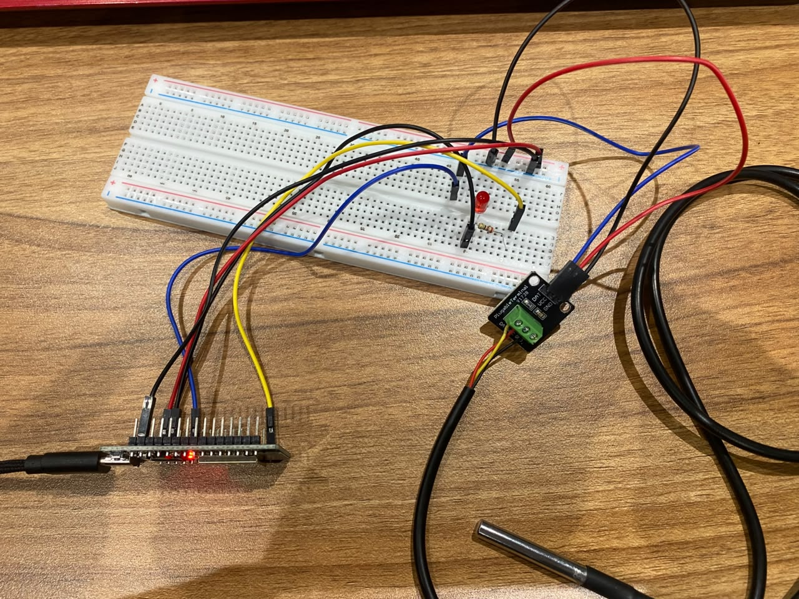
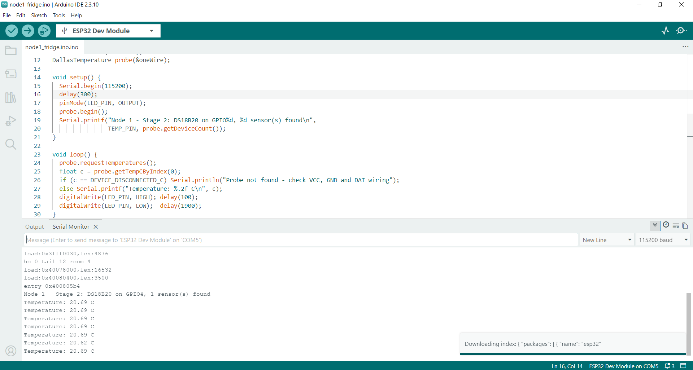
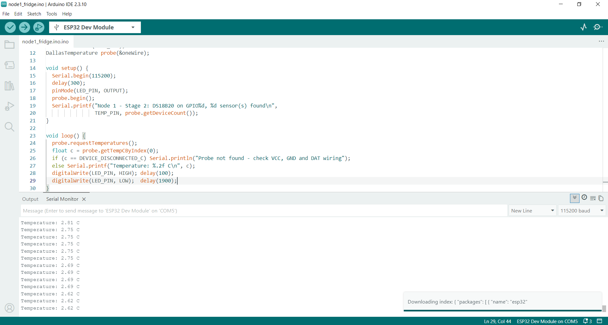
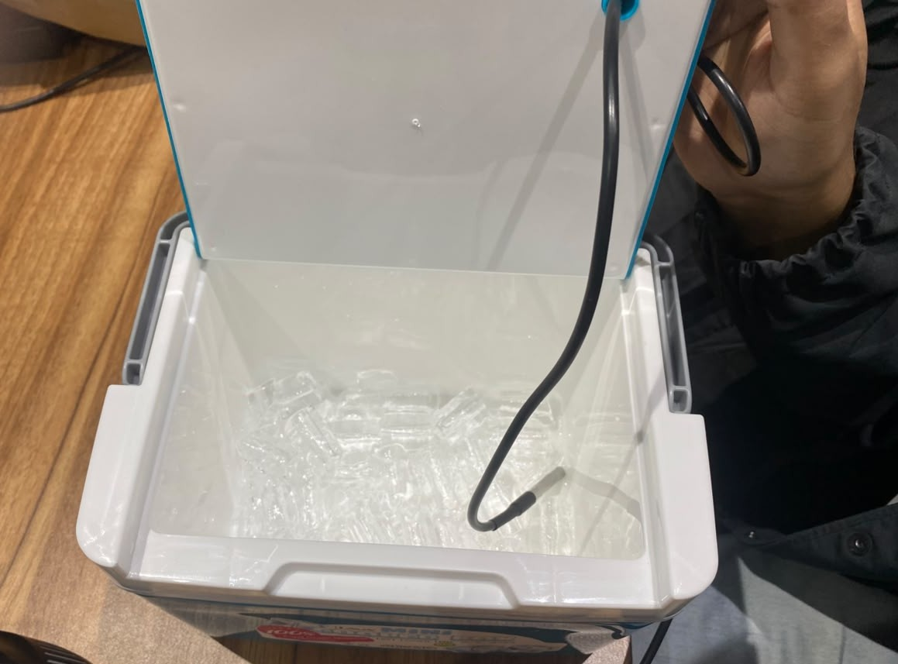

# Stage 2: DS18B20 temperature probe

**Goal:** read the fridge temperature on Node 1, prove the reading tracks real changes
(positive tests), and prove a broken probe is noticed instead of reporting a wrong number
(negative test).

## Hardware

| Part | Detail |
|------|--------|
| DS18B20 waterproof probe | 1-Wire digital temperature sensor, ±0.5 °C |
| DS18B20 adapter module | screw terminal for the probe, pull-up resistor on DAT built in |
| 6 female-to-male jumpers | 3 from the ESP32, 3 from the module |

## Wiring

| # | Wire | From | To |
|---|------|------|----|
| 1 | Red | ESP32 3V3 | bottom + rail |
| 2 | Black | ESP32 GND (the second GND pin, not the LED's) | bottom − rail |
| 3 | Red | module VCC | bottom + rail |
| 4 | Black | module GND | bottom − rail |
| 5 | Blue | module DAT | hole j14 |
| 6 | Blue | ESP32 pin 4 | hole f14 (same column as j14) |

Probe into the module's screw terminal: red → VCC, black → GND, yellow → DAT.

**Why GPIO4:** a general-purpose pin that is not a strapping pin (0, 2, 5, 12, 15), not wired to
the flash chip (6–11) and not input-only (34–39).

**Why the adapter module:** the 1-Wire bus needs a pull-up resistor (usually 4.7 kΩ) on the data
line. The module has it built in, so the breadboard needs no extra resistor.

**Why it matters:** temperature is the safety-critical value in this system, because vaccines
must stay between 2 and 8 °C. Requirement SR-13 says an over-temperature lasting more than
10 minutes must raise an alarm within 60 s; later stages protect this reading in transit.

## Firmware

Reads the probe with the OneWire and DallasTemperature libraries and prints each reading to the
Serial Monitor at 115200 baud.

**LED heartbeat:** the red LED flashes once per reading (0.1 s on, 1.9 s off, plus up to 0.75 s
while the probe converts, so about every 2.75 s). A steady rhythm shows the board is alive; if it
stops, the firmware has frozen. From Stage 8 the LED takes on its real job as the
security-breach indicator.

## Tests

| # | Test | Type | Expected | Result |
|---|------|------|----------|--------|
| 1 | Room temperature | Positive | Steady reading, "1 sensor(s) found" at boot | ✅ 20.4 °C (air-conditioned room) |
| 2 | Hold the probe tip | Positive | Reading rises, then levels off | ✅ rose to 21.4 °C |
| 3 | Probe on an ice pack | Positive | Reading falls | ✅ dropped to 2.75 °C |
| 4 | Pull DAT out of j14 | Negative | "Probe not found" | ✅ reported on the next reading (within about 3 s); readings resumed after reconnecting |

Test 4 matters for security: a cut or loose probe wire is reported as a fault, not hidden behind
a plausible-looking temperature. In later stages this becomes an alert to the backend.

## 📸 Evidence

| File | Shows |
|------|-------|
| `01_stage2_wiring.jpg` | Wiring, with the pin and module labels readable |
| `02_serial_room_temp.png` | Boot line "1 sensor(s) found" and steady room readings |
| `03_serial_hand_temp.png` | Readings rising while the probe is held |
| `04_serial_ice_pack.png` | Readings falling on the ice pack |
| `05_serial_dat_unplugged.png` | Negative test: "Probe not found", then recovery |

## Problems & fixes

- **Three COM ports listed (COM3, COM4, COM5).** Found the ESP32 by unplugging and replugging it
  and watching which port disappeared: the CH340 was COM5.
- **The sketch was saved outside the repo as `node1_fridge.ino.ino`.** The IDE had saved it as a
  new sketch named "node1_fridge.ino". Fix: opened the repo's
  `firmware/node1_fridge/node1_fridge.ino`, pasted the code in, saved, and deleted the stray
  sketch folder.

## Result

- [x] Stage 2: the DS18B20 reads correctly at room, hand and ice-pack temperatures, and a
  disconnected probe is reported as "Probe not found".

**Next:** Stage 3, the reed switch on GPIO19 (`../stage_3/03-reed-switch-door.md`).
