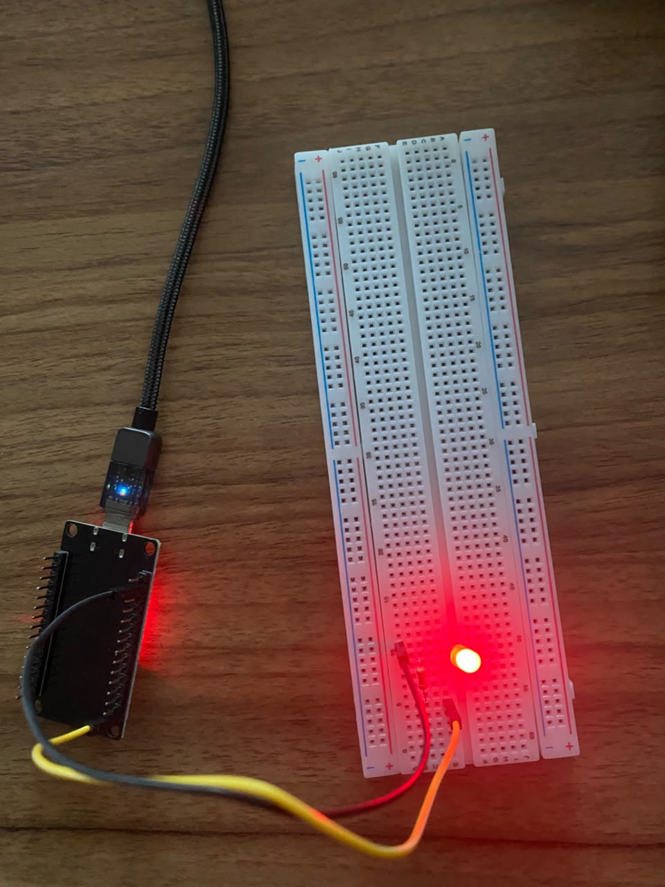
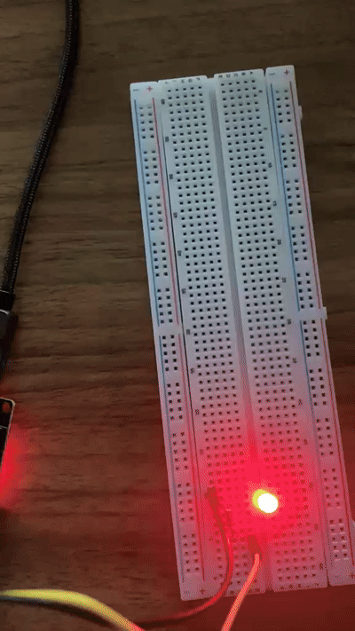
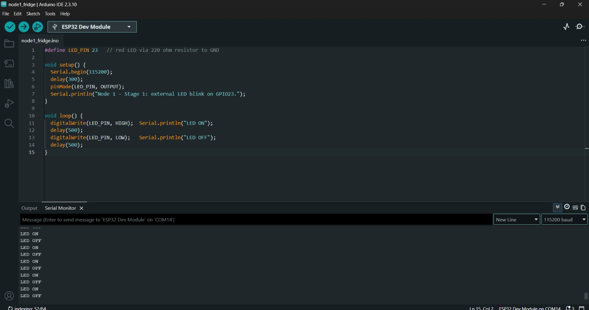

# Stages 0–1: Toolchain + security LED

**Goal:** prove the toolchain can flash the ESP32 (Stage 0), then drive the first external part,
the red security-breach LED on Node 1 (Stage 1).

## Hardware

|Part|Detail|
|-|-|
|ESP32-DevKitC|ESP32-D0WD-V3, CH340C USB-to-serial|
|Red 5 mm LED|Node 1's security-breach indicator|
|220 Ω resistor|red-red-brown-gold, ¼ W|
|MB102 breadboard + 2 female-to-male jumpers||

## Stage 0: Toolchain

* Installed the CH340 USB driver (the board uses a CH340C chip)
* Installed Arduino IDE 2.3.10 and the **esp32 by Espressif Systems** core 3.3.12 from Boards Manager
* Board: **ESP32 Dev Module** · Port: COM13
* Uploaded `firmware/node1\_fridge/node1\_fridge.ino`: upload completed and the Serial Monitor (115200 baud) printed the sketch's messages

## Stage 1: Security LED on GPIO23

**Circuit:** GPIO23 → 220 Ω → LED long leg (+) → LED short leg (−) → GND

|#|Part|From|To|
|-|-|-|-|
|1|Yellow F-M jumper|ESP32 pin 23|hole e5|
|2|220 Ω resistor|b5|b10|
|3|Red LED|long leg (+) in e10|short leg (−) in e11|
|4|Black F-M jumper|ESP32 GND|hole a11|

**Why GPIO23:** it is not a strapping pin (0, 2, 5, 12, 15), not wired to the flash chip (6–11)
and not input-only (34–39), so it is a safe output that does not affect boot.

**Why 220 Ω:** (3.3 V − \~2.0 V LED drop) / 220 Ω ≈ 6 mA. That is bright enough to see and well
within what an ESP32 pin can supply.

**Why this LED matters for security:** in later stages it lights when the backend sends a
breach alert to Node 1 on `campus/sensor01/cmd`. Staff at the fridge get a physical warning
that does not depend on anyone watching a dashboard.

## 📸 Evidence

| # | File | Shows |
|---|------|-------|
| 1 | `01_serial_led.jpg` | Serial Monitor printing `LED ON` / `LED OFF` |
| 2 | `02_stage1_led_wiring.jpg` | Stage 1 wiring on the breadboard |
| 3 | `03_led_blink.gif` | The red LED blinking at 1 Hz |

## Problems \& fixes

* **Boards Manager showed nothing for "esp32" at first.** 
* **`redefinition of 'void setup()'` on compile.** Two `.ino` files were in the same sketch
folder, and Arduino merges every `.ino` in a folder into one program. Fix: one sketch per
folder; open `firmware/node1\_fridge/node1\_fridge.ino` on its own.
* **Pin labels sit in different positions from the reference pinout** (pin 23 is at the bottom
on my board). Fix: always wire by the label printed on the board, never by position.

## Result

* \[x] Stage 0: sketch compiles, uploads over the CH340 and prints to the Serial Monitor at 115200 baud
* \[x] Stage 1: red LED on GPIO23 blinks at 1 Hz (1 s on, 1 s off), in step with `LED ON` / `LED OFF` on serial

**Next:** Stage 2, the DS18B20 temperature probe on GPIO4 (`docs/02-node1-sensors.md`).

