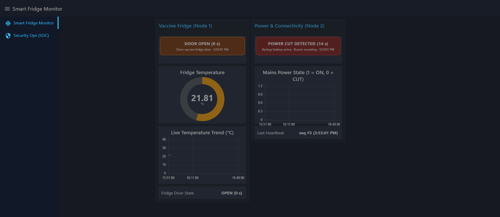
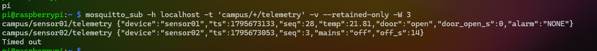
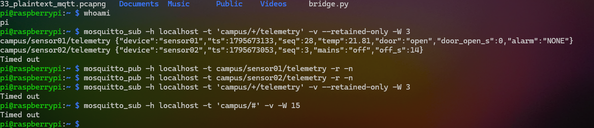
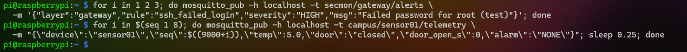
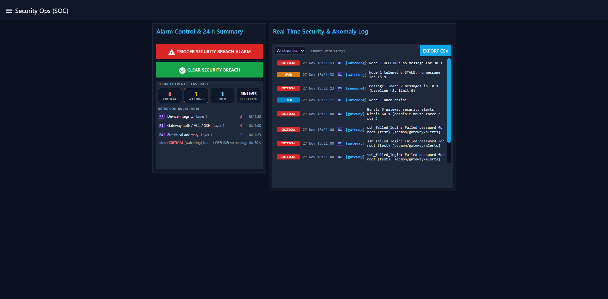
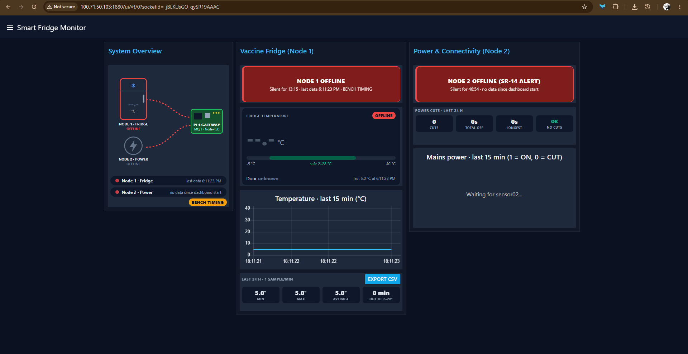

# Stage 12 — 2-Layer Security Monitoring Dashboard (`M10`)

**Goal:** Upgrade the Node-RED **Security Ops (SOC)** dashboard to monitor **≥ 2 architectural layers** with **≥ 3 alert rules**, including **≥ 1 statistical rule**, each firing in **< 60 s**. The Smart Fridge Monitor tab was also redesigned so clinic staff can see sensor health, live timers and 24 h history at a glance.

> **Scope of this write-up:** `M10` (Person 2 — Node-RED). The Layer 2 log source `logshipper.py` (`90_`) and the CRL revocation drill `M11` (`92_`) belong to Person 1 and are documented separately. Until `logshipper.py` runs, Rule R2 was exercised by publishing the same JSON format to `secmon/gateway/alerts` by hand.

**Date tested:** 27 Nov 2026 · **Node-RED** 5.0.10 · **node-red-dashboard** 3.6.6 · **Branch:** `dashboard/redesign` · **Flow:** [`gateway/dashboard.json`](../../../gateway/dashboard.json)

---

## 1. Detection rules (`M10`)

| Rule | Layer | Source topic | Fires on | Severity | Time to alert |
| :--- | :--- | :--- | :--- | :--- | :--- |
| **R1 Device integrity** | 1 — Device | `campus/+/telemetry` | `seq` replay (`seq <= last`) or gap (`seq > last + 1`); implausible/spoofed temperature (`< -20` / `> 60 °C`, or `fake:true`); malformed JSON; **retained** (replayed) telemetry; LWT offline; **watchdog** STALE after 15 s / OFFLINE after 30 s of silence (`SR-14`) | WARN / CRITICAL | On the message; watchdog 15 s / 30 s |
| **R2 Gateway auth / ACL / SSH** | 2 — Gateway | `secmon/#` | Any alert from `logshipper.py` (TLS handshake failure, ACL denial, SSH failed login); **burst** CRITICAL when 3 alerts arrive within 60 s | mapped from `severity` (HIGH → CRITICAL, MEDIUM → WARN, LOW → INFO) | On the message |
| **R3 Statistical anomaly** | 1 — Device | `campus/+/telemetry` | **(a) Message flood:** > 6 messages from one sensor in a sliding 10 s window (baseline ≈ 2, firmware publishes every 5 s). **(b) Temperature z-score:** `|temp − mean₁₀| > 3 × max(σ₁₀, 0.2 °C)` over the previous 10 readings | CRITICAL / WARN | On the message |

**How it is wired:** each rule is its own Node-RED function node and sends `{sev, src, rule, text}` events to a single **Event Log** node. The Event Log saves events in the `file` context store (90-day / 1000-row retention, survives restarts) and feeds the SOC tab:
- an **event feed** with an `R1`/`R2`/`R3` chip on each row, a severity filter and **Export CSV**;
- a **24 h summary** with critical/warning/info counts and, for each rule, its 24 h count and last fire time.

```
campus/sensor01/telemetry ─┬─► Process Node 1 ──► R1 checks ─────────┐
                           ├─► R3a Message flood ──────────────────────┤
                           │        └─► temp ──► R3b Z-score ──────────┤
campus/sensor02/telemetry ─┼─► Process Node 2 ──► R1 checks ─────────┤──► Event Log ──► SOC feed + 24 h summary
                           └─► R3a Message flood ──────────────────────┤      (file store, 90 days)
1 s tick ──► Render Fridge / Power ──► R1 watchdog (STALE / OFFLINE) ──┤
secmon/# ──► R2 Gateway alerts (+ burst) ──────────────────────────────┘
```

**Design decisions**
- **Z-score uses σ as a floor, not a gate.** The handoff example only checks when `σ > 0.2`. A steady fridge has σ ≈ 0, so that version would *miss* a sudden spoofed jump. Using `max(σ, 0.2 °C)` ignores tiny sensor noise but still catches real jumps.
- **`secmon/#` payloads are untrusted.** R2 parses them defensively, keeps only known fields, caps text at 160 characters and strips line breaks, so a forged alert cannot break the feed.
- **CSV export is injection-safe.** Event text can contain attacker-controlled data (e.g. a malformed payload snippet). Cells starting with `=`, `+`, `-` or `@` get a `'` prefix so a spreadsheet will not run them as formulas (OWASP CSV injection).
- **Least privilege kept.** The dashboard only reads `campus/+/telemetry` and `secmon/#` and only writes `campus/sensor01/cmd`, so it already fits the Stage 9 ACL for user `dashboard`. No telemetry or command topics changed.

---

## 2. Dashboard changes (Stages 8 → 12)

| Commit | Change |
| :--- | :--- |
| `febfa56` | Alert thresholds in one **Alert Config** node mirroring firmware `BENCH_TIMING`; freeze alert < 2 °C; temperature alerts no longer hidden behind "door open"; live door-open and power-cut timers; **watchdog**; retained/malformed telemetry handled |
| `682ee8a` | Event log persisted (`file` store) with full dates; severity filter; **CSV export** of events and of a 24 h fridge temperature log |
| `12cb802`, `ac1f8f9`, `499b363` | Visual redesign: **System Overview** diagram (fridge door, mains power, Pi gateway, links coloured by health), temperature card with safe band, 24 h fridge and power-cut KPIs, SOC 24 h summary |
| `f1f537c` | **R1 tags, R2 `secmon/#` rule with burst, R3 message-flood + z-score rules**, rule chips, rule column in CSV, per-rule summary |

> Requires `contextStorage` with a `file` (`localfilesystem`) store in `~/.node-red/settings.js` on the Pi — see [`gateway/README.md`](../../../gateway/README.md).

---

## 3. Tests

### 3.1 Live tests on the Raspberry Pi (27 Nov 2026)

Commands run on the Pi (`91d_rule_trigger_commands.png`):

```bash
# R2 — three gateway alerts within 60 s
for i in 1 2 3; do mosquitto_pub -h localhost -t secmon/gateway/alerts \
  -m '{"layer":"gateway","rule":"ssh_failed_login","severity":"HIGH","msg":"Failed password for root (test)"}'; done

# R3 — 8 telemetry messages in ~2 s
for i in $(seq 1 8); do mosquitto_pub -h localhost -t campus/sensor01/telemetry \
  -m "{\"device\":\"sensor01\",\"seq\":$((9000+i)),\"temp\":5.0,\"door\":\"closed\",\"door_open_s\":0,\"alarm\":\"NONE\"}"; sleep 0.25; done
```

Events recorded by the dashboard (read back from the Event Log):

| Time | Sev | Rule | Source | Event | Delay after trigger |
| :--- | :--- | :--- | :--- | :--- | :--- |
| 18:11:00 | CRITICAL | R2 | gateway | `ssh_failed_login: Failed password for root (test) [secmon/gateway/alerts]` ×3 | same second |
| 18:11:00 | CRITICAL | R2 | gateway | `Burst: 3 gateway security alerts within 60 s (possible brute force / scan)` | same second |
| 18:11:21 | INFO | R1 | watchdog | `Node 1 back online` | — |
| 18:11:23 | CRITICAL | R3 | sensor01 | `Message flood: 7 messages in 10 s (baseline ~2, limit 6)` | ≈ 2 s |
| 18:11:38 | WARN | R1 | watchdog | `Node 1 telemetry STALE: no message for 15 s` | 15 s |
| 18:11:53 | CRITICAL | R1 | watchdog | `Node 1 OFFLINE: no message for 30 s` | 30 s |

| # | Test | Type | Expected | Result |
| :--- | :--- | :--- | :--- | :--- |
| L1 | 3 × `ssh_failed_login` on `secmon/gateway/alerts` | Positive (R2, Layer 2) | 3 CRITICAL + 1 Burst in the SOC feed within 60 s | ✅ All 4 at 18:11:00 |
| L2 | 8 telemetry messages in ~2 s | Positive (R3a, statistical) | One CRITICAL message-flood alert within 60 s | ✅ 18:11:23, ≈ 2 s after the first message |
| L3 | Sensor silent after L2 | Positive (R1 watchdog, `SR-14`) | STALE at 15 s, OFFLINE at 30 s | ✅ 18:11:38 / 18:11:53 |
| L4 | Both ESP32s powered off | Positive (R1 watchdog) | Both nodes flagged OFFLINE, banners red, overview links broken | ✅ 17:41:55, both `OFFLINE` |
| L5 | Broker holds retained telemetry from 26 Nov (`91b_`) | Negative / before-after (R1) | Replayed message ignored, not shown as live; WARN logged | ✅ `Ignored RETAINED telemetry (seq=28)` and `(seq=3)` at 17:09:51 |
| L6 | Export CSV with filter = WARN (no WARN events) | Negative | Header-only file | ✅ `time_local,severity,source,event` only |
| L7 | Export CSV, all severities | Positive | Dated rows | ✅ e.g. `2026-11-27 17:41:55,CRITICAL,watchdog,Node 2 OFFLINE…` (exported before the `rule` column was added) |
| L8 | Fridge temperature Export CSV after the test | Positive | 1 sample/min with date, temp, door, alarm, seq | ✅ `2026-11-27 18:11:21,5,CLOSED,NONE,9001` (`91f_`) |

### 3.2 Logic tests (Node.js harness, real function code from `dashboard.json`)

The function nodes were run with a simulated clock and messages; all assertions passed.

| # | Test | Type | Result |
| :--- | :--- | :--- | :--- |
| U1 | Normal 5 s cadence for 150 s | Negative (R3a) | ✅ No flood alert |
| U2 | 7 messages in 3.5 s → alert; more messages within 60 s | Positive + cooldown (R3a) | ✅ One alert; fires again only after 60 s cooldown |
| U3 | Separate windows per sensor | Negative (R3a) | ✅ `sensor02` traffic does not count toward `sensor01` |
| U4 | Readings 4.9–5.1 °C, then 5.4 °C | Negative (R3b) | ✅ No alert (within 3 × 0.2 °C floor) |
| U5 | Then 14.2 °C | Positive (R3b) | ✅ `Temperature anomaly: 14.20 °C vs rolling mean 5.0x °C` |
| U6 | 500-character `secmon` message with a newline | Negative / robustness (R2) | ✅ Clipped, newline removed |
| U7 | Retained `secmon` message | Negative (R2) | ✅ Ignored |
| U8 | Plain-text (non-JSON) `secmon` message | Robustness (R2) | ✅ Logged as WARN |
| U9 | Malformed telemetry `{bad` | Robustness (R1) | ✅ Logged `Malformed telemetry dropped`, no crash |
| U10 | Replayed `seq` | Positive (R1) | ✅ Tagged R1; operational alarms (door/temp) not tagged |
| U11 | CSV cell `=HYPERLINK("http://evil")` | Negative (CSV injection) | ✅ Exported as `'=HYPERLINK(...)` |
| U12 | Events older than 90 days / more than 1000 rows | Retention (`M12`) | ✅ Pruned |

---

## 4. Before vs. After

| Before (Stage 8) | After (Stage 12) |
| :--- | :--- |
| Dashboard showed **yesterday's reading as live** (`21.81 °C`, "DOOR OPEN (0 s)", seq #3) after both sensors had stopped — no staleness detection (`91a_`) | Watchdog marks nodes STALE (15 s) / OFFLINE (30 s); reading blanks to `--.-` with "last X °C at hh:mm" |
| Stage 8 test 4 logged `Replay or duplicate seq detected (176 <= 176)`; on this Pi the same appeared as `(28 <= 28)` — caused by a **retained** message the broker replayed on every reconnect (`91b_`) | Retained telemetry is detected, ignored and logged as `R1` WARN; the stale retained messages were cleared (`91c_`) |
| Single Layer 1 source; checks not labelled; 12 events in memory, time only, lost on restart | 2 layers, 3 labelled rules (R1/R2/R3) incl. statistical; 90-day persistent log with dates, filter and CSV export |
| Door timer frozen between messages; temperature warning hidden while door open; no freeze alert | Live door/power-cut timers; temperature alerts take priority; freeze-risk alert < 2 °C |

---

## 5. 📸 Evidence

| File | Shows | Status |
| :--- | :--- | :--- |
| `91a_dashboard_before.png` | Stage 8 dashboard showing stale data as live (before) | ✅ Added |
| `91b_retained_stale_telemetry.png` | `mosquitto_sub --retained-only` showing 26 Nov telemetry still retained on the broker | ✅ Added |
| `91c_retained_cleared.png` | Retained messages cleared (`-r -n`), no live traffic while sensors were off | ✅ Added |
| `91d_rule_trigger_commands.png` | R2 and R3 trigger commands run on the Pi | ✅ Added |
| **`91_soc_2layers_3alerts.png`** | **SOC tab after the live test: R1/R2/R3 chips in the feed; rule summary R1 = 3, R2 = 4, R3 = 1; 8 critical / 1 warning / 1 info in 24 h** (`M10` main evidence) | ✅ Added |
| `91e_dashboard_coldchain_after.png` | Redesigned Smart Fridge Monitor after the test: System Overview, temperature card ("last 5.0 °C at 6:11:23 PM"), trend chart, 24 h KPIs (min/max/avg 5.0°, 0 min out of range) | ✅ Added (sensors offline) |
| `91f_fridge_temperature_export.csv` | Fridge **Export CSV**: one sample from the R3 test message (`2026-11-27 18:11:21, 5, CLOSED, NONE, 9001`) — test data, not a real fridge reading | ✅ Added |













---

## 6. Limitations & follow-ups

- **R2 source:** tested with manual `mosquitto_pub` in the `logshipper.py` JSON format. Re-capture with real Mosquitto/SSH failures once Person 1's `logshipper.py` runs (`90_`).
- **Test data reached Mobius:** if `bridge.py` was running, the 8 R3 test readings (seq 9001–9008, 5.0 °C) were forwarded to Mobius.
- **Still on plaintext 1883:** the dashboard switches to mTLS `8883` with `dashboard.crt` in Stage 9 Task 9.6; the rule commands then need the TLS options.
- **No dashboard login yet:** `httpNodeAuth` / `adminAuth` are part of Stage 10 RBAC (`M6`).
- **Timings:** rules were tested with `BENCH_TIMING 1` (28 °C / 10 s, door 15 s). Switch the **Alert Config** node together with the firmware for clinic timings.

---

## 7. Result

- [x] **≥ 2 layers:** Layer 1 device telemetry (`campus/+/telemetry`) + Layer 2 gateway alerts (`secmon/#`)
- [x] **≥ 3 alert rules:** R1 device integrity, R2 gateway auth/ACL/SSH, R3 statistical anomaly
- [x] **≥ 1 statistical rule:** R3 message-flood (sliding window) + temperature z-score
- [x] **All fire < 60 s:** R2 same second, R3 ≈ 2 s, R1 watchdog 15 s / 30 s (live test 27 Nov 2026)
- [x] Main screenshot `91_soc_2layers_3alerts.png` added

**Next:** Person 1 — `logshipper.py` (`90_`) and revocation drill (`M11`, `92_`); Person 2 — Stage 9 Task 9.6 (dashboard on `8883`).
