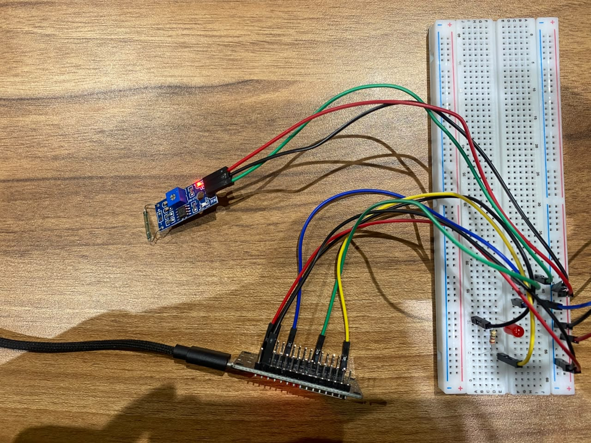
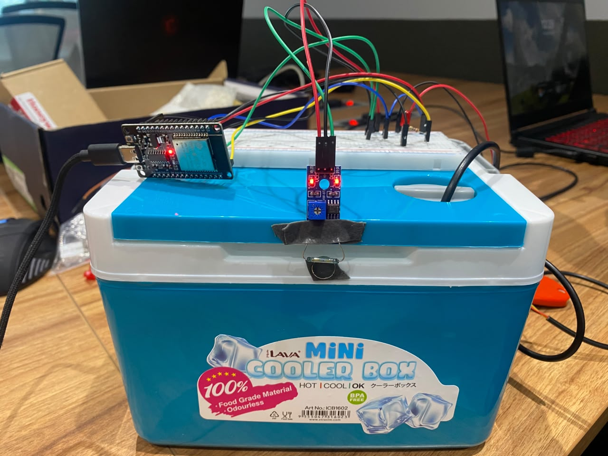
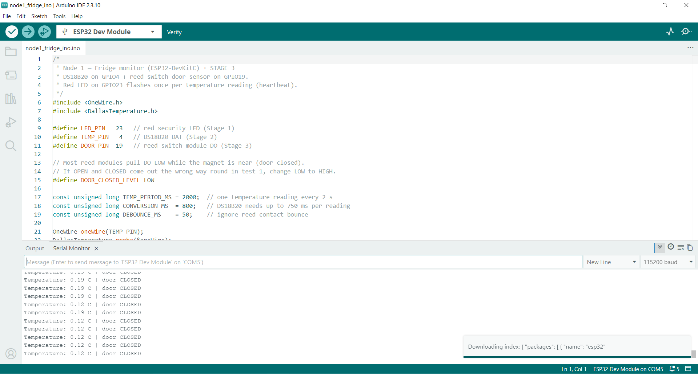
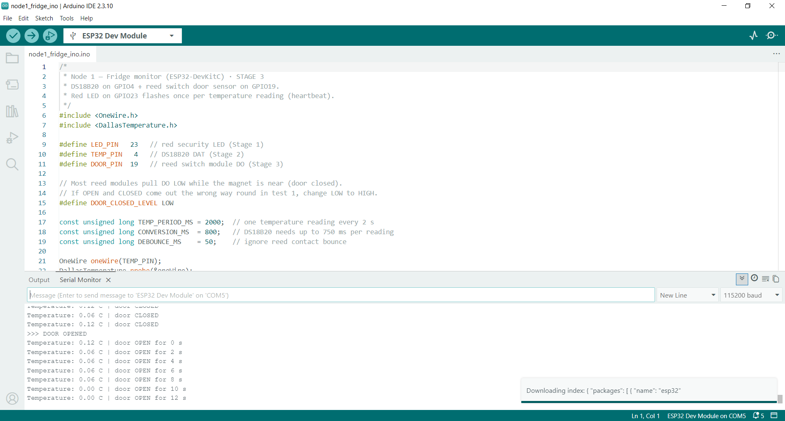
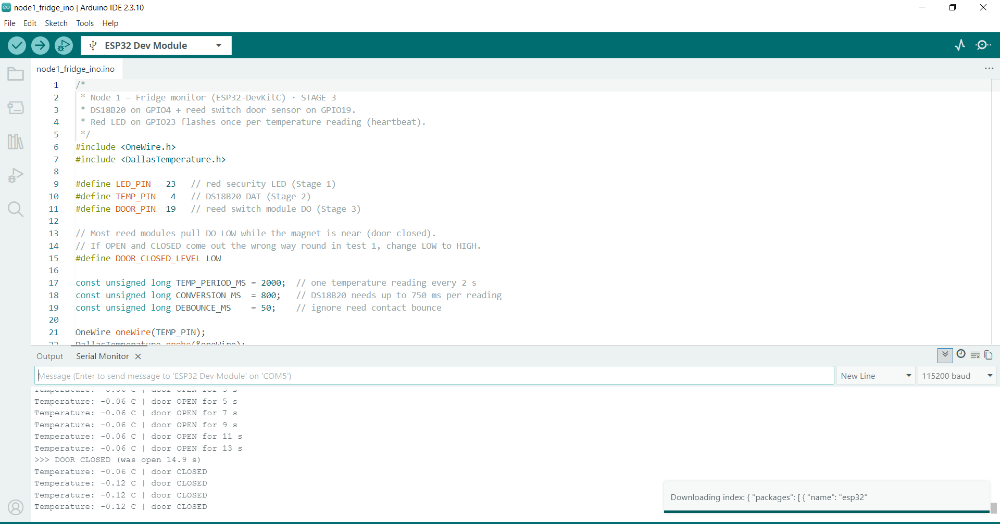

# Stage 3: Reed switch for the door

**Goal:** detect the fridge door (the box lid) opening and closing, report each change straight
away, time how long the door stays open, and make a cut sensor wire fail safe.

## Hardware

| Part | Detail |
|------|--------|
| Reed switch module (LM393) | glass reed switch + comparator, digital output DO, signal LED |
| Neodymium magnet | 10 mm disc; goes on the lid edge, closes the reed when the lid shuts |
| 4 female-to-male jumpers | 3 from the module, 1 from the ESP32 |

## Wiring

| # | Wire | From | To |
|---|------|------|----|
| 1 | Red | module VCC | bottom + rail |
| 2 | Black | module GND | bottom − rail |
| 3 | Green | module DO | hole j18 |
| 4 | Green | ESP32 pin 19 | hole f18 (same column as j18) |

No new power wires from the ESP32: the Stage 2 3V3 and GND wires already feed the rails.

**Why GPIO19:** general purpose, and not a strapping, flash or input-only pin.

## Firmware

- **Debounce:** a reed contact bounces for a few milliseconds when it moves, so a change is only
  accepted once the reading has been steady for 50 ms. One door movement = one event.
- **Non-blocking temperature reads:** the probe now converts in the background
  (`setWaitForConversion(false)`), so the door is checked continuously instead of being frozen for
  0.75 s per reading. The LED heartbeat is now every 2 s.
- **Door-open timer:** each status line shows how long the door has been open, and the close
  event reports the total. Stage 4 uses this for the door-open alarm (SR-13: open > 5 min).
- **Fail-safe input:** pin 19 uses the internal pull-up, so a disconnected DO wire reads as
  **OPEN**. A cut wire raises the alarm instead of hiding an open door.
- Door polarity: magnet near = DO __ (LOW/HIGH) = CLOSED. _(Had to flip `DOOR_CLOSED_LEVEL`: yes / no)_

## Tests

| # | Test | Type | Expected | Result |
|---|------|------|----------|--------|
| 1 | Magnet against the reed, then away | Positive | CLOSED, then OPEN | ✅ module signal LED __ when the magnet is near |
| 2 | Open and close | Positive | `>>> DOOR OPENED`, open timer counting, `>>> DOOR CLOSED (was open x s)` | ✅ |
| 3 | Switching distance | Measurement | Switches within ~1 cm | ✅ switches to CLOSED at __ mm |
| 4 | Fast open/close | Robustness | One line per change, no duplicates | ✅ debounce works |
| 5 | Pull DO out of j18 | Negative | Reads OPEN (fail-safe) | ✅ OPEN while unplugged, CLOSED again after reconnecting |

The switching distance sets where the magnet goes on the lid: the gap between magnet and reed
must stay below __ mm when the lid is shut.

## 📸 Evidence

| File | Shows |
|------|-------|
| `06_stage3_wiring.jpg` | Wiring, with the module and pin labels readable |
| `07_serial_door_closed.png` | Door closed: magnet against the reed |
| `08_serial_door_open.PNG` | Door opened: open timer counting, then closed again |
| `09_serial_bounce.png` | Fast open/close giving one line per change |
| `10_serial_do_unplugged.PNG` | Negative test: OPEN while DO is unplugged, then recovery |
| `11_reed_mount.jpg` | Reed module and magnet in position |

## Result

- [x] Stage 3: door changes are reported once each and straight away, the open time is tracked,
  and a disconnected sensor wire fails safe as OPEN.

**Next:** Stage 4, the buzzer alarms on GPIO18 (`../stage_4/04-buzzer-alarms.md`).
