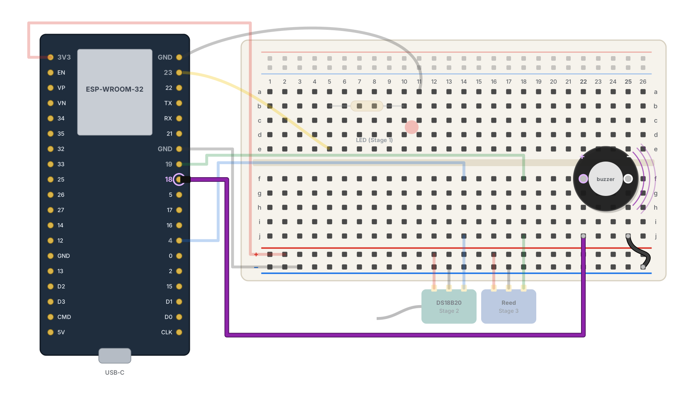
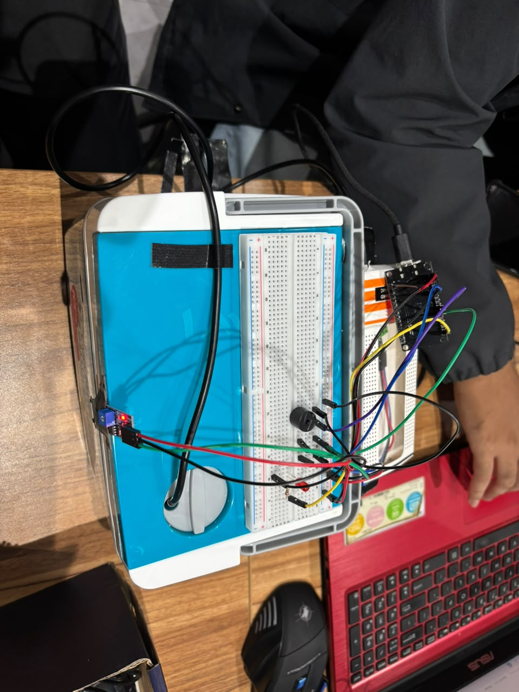
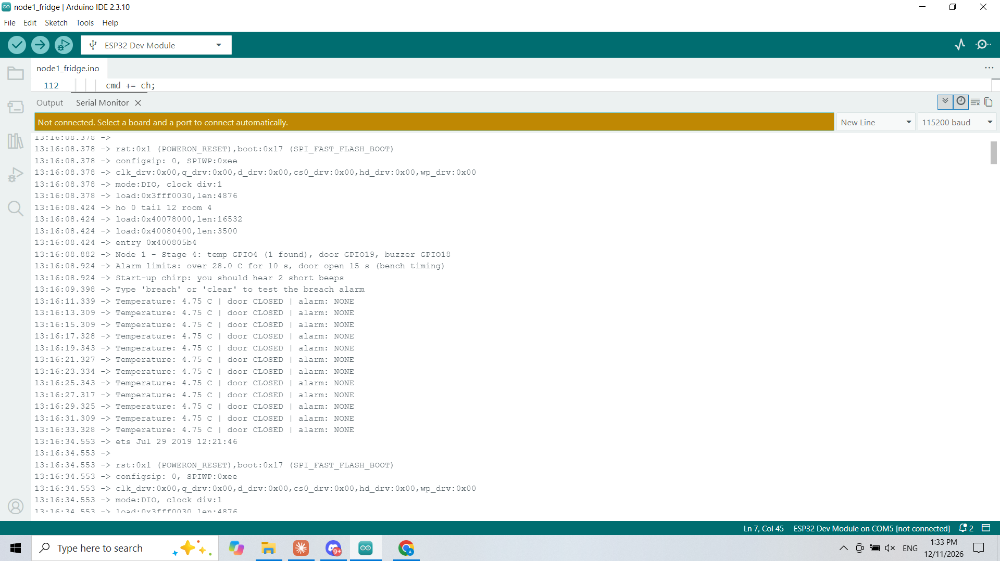
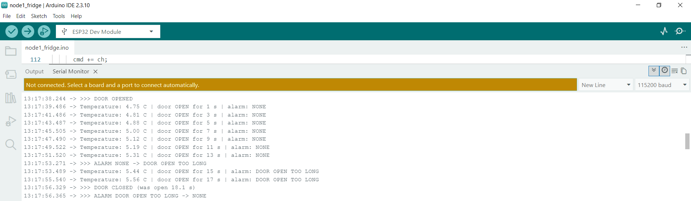
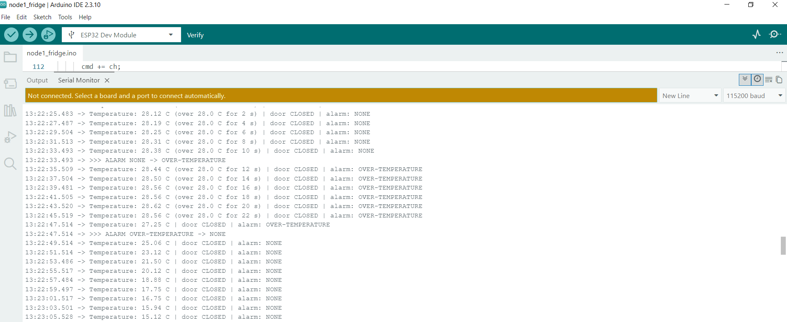
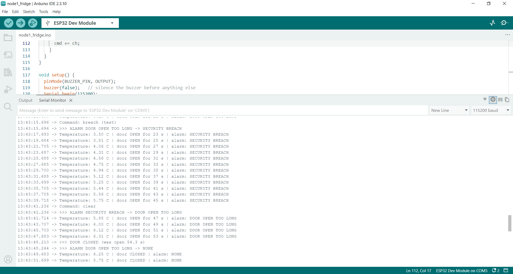
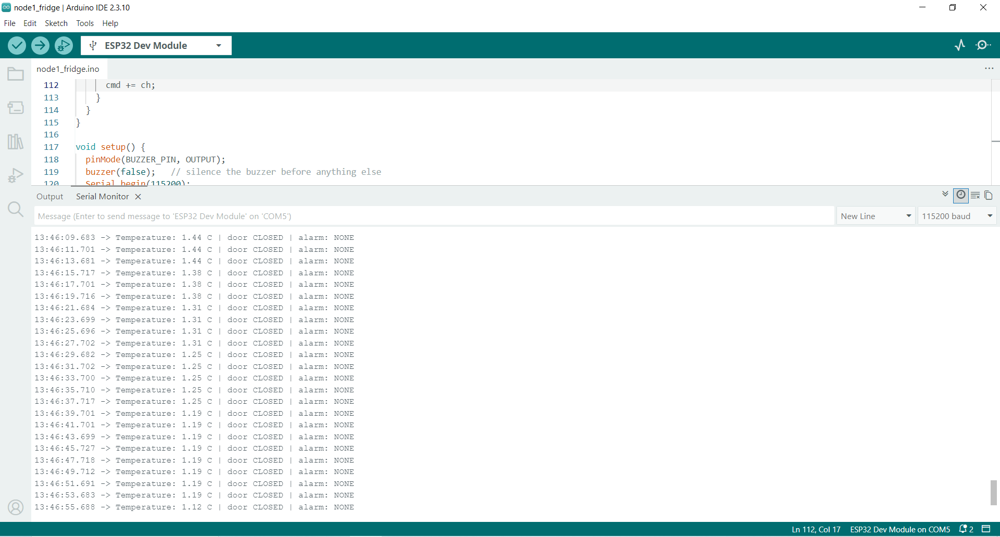

# Stage 4: Buzzer alarms (Node 1 complete)

**Node 1 pin map (complete)**

| ESP32 pin | Part | Stage |
|---|---|---|
| GPIO23 | 220 Ω → red LED → GND (security-breach indicator) | 1 |
| GPIO4 | DS18B20 module DAT | 2 |
| GPIO19 | reed switch module DO | 3 |
| GPIO18 | bare active buzzer (+ leg) | 4 |
| 3V3 / GND | bottom + / − rails | 2 |

The final Node 1 sketch is `firmware/node1_fridge/node1_fridge.ino`.

**Goal:** sound a local alarm when the fridge needs attention (SR-13), with a different sound for
each cause, and prove that short, harmless events do not set it off.

## Hardware

| Part | Detail |
|------|--------|
| Active buzzer (bare, 2 legs) | built-in tone generator: sounds whenever its + leg is driven HIGH |
| 1 female-to-male jumper + 1 male-to-male jumper | pin 18 to the buzzer, buzzer to the − rail |

## Wiring

| # | Part | From | To |
|---|------|------|----|
| – | Buzzer long leg (+) | | hole f22 |
| – | Buzzer short leg (−) | | hole f25 |
| 1 | Purple F-M jumper | ESP32 pin 18 | hole j22 |
| 2 | Black M-M jumper | hole j25 | bottom − rail |

My ESP32 has only two GND pins and both were already in use (LED and − rail), so the buzzer takes
GND from the − rail. An active buzzer draws roughly 15–25 mA at 3.3 V, within what one ESP32 pin
can supply, so it needs no transistor.

## Firmware

Three alarms, each with its own sound, so staff can tell them apart without looking:

| Alarm | Trigger (bench timing) | Trigger (real, SR-13) | Sound |
|-------|------------------------|------------------------|-------|
| Door open too long | door open 15 s | door open 5 min | double chirp every 2 s |
| Over-temperature | above 28 °C for 10 s | above 8 °C for 10 min | slow: 1 s on, 1 s off |
| Security breach | `breach` typed in the Serial Monitor | command from the backend (Stage 8) | fast and continuous, red LED on solid |

- **Priority:** breach beats over-temperature, which beats door. Clearing a breach falls back to
  whatever alarm is still active.
- **Hold-off timers:** an alarm only sounds once its condition has lasted the full time, so a
  quick door opening or a brief warm spike does not cause a false alarm.
- **Hysteresis:** the over-temperature alarm clears only once the reading falls 0.5 °C below the
  limit, so it doesn't flicker on and off at the threshold.
- **Bench vs real timing:** `#define BENCH_TIMING 1` uses short limits for testing at a desk;
  `0` switches to the real SR-13 values for the fridge.
- **Non-blocking:** the buzzer patterns run on `millis()`, so the door and temperature are still
  checked while an alarm is sounding.
- Bench limit used: __ °C _(28 °C, or 26 °C if the hand test couldn't reach 28)_

## Tests

Timestamps come from the Serial Monitor's clock option, so the delays can be read straight off the
screenshots.

| # | Test | Type | Expected | Result |
|---|------|------|----------|--------|
| 1 | Press EN | Positive | 2 short beeps at start-up | ✅ |
| 2 | Door open 15 s | Positive | `DOOR OPEN TOO LONG`, double chirp; stops when closed | ✅ alarm __ s after opening |
| 3 | Probe warmed past the limit for 10 s | Positive | `OVER-TEMPERATURE`, slow beeps; clears after cooling | ✅ peak 28 °C |
| 4 | `breach`, then `clear` | Positive | Fast beeps + LED solid; stops on `clear` | ✅ |
| 5 | `breach` during a door alarm | Priority | Breach takes over; door alarm returns after `clear` | ✅ |
| 6 | Door open < 15 s; probe warm < 10 s | Negative | No alarm at all | ✅ `alarm: NONE` throughout |

## 📸 Evidence

| File | Shows |
|------|-------|
| `12_stage4_wiring.png` | Buzzer and jumper positions |
| `13_node1_complete.jpg` | The finished Node 1 |
| `14_serial_startup.png` | Start-up lines and the alarm limits |
| `15_serial_door_alarm.png` | Door alarm and recovery |
| `16_serial_temp_alarm.png` | Over-temperature countdown, alarm and recovery |
| `17_serial_breach.png` | Breach taking priority, then `clear` |
| `18_serial_no_false_alarm.png` | Negative test: no false alarms |

## Problems & fixes

- **The parts list said "buzzer module", but I had a bare buzzer.** A bare active buzzer plugs
  straight into the breadboard and is driven HIGH = on (the module version was LOW = on).
- **Only two GND pins on the ESP32.** Took the buzzer's GND from the − rail instead.

## Result

- [x] Stage 4: all three alarms sound with their own patterns, breach takes priority, and short
  events cause no false alarms. **Node 1 is complete.**

**Next:** Stage 5, Node 2's power-loss detection (`../stage_5/05-node2-power.md`).
