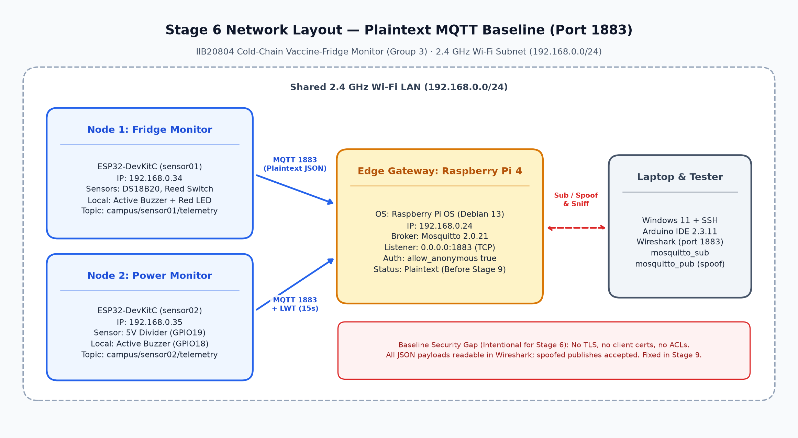
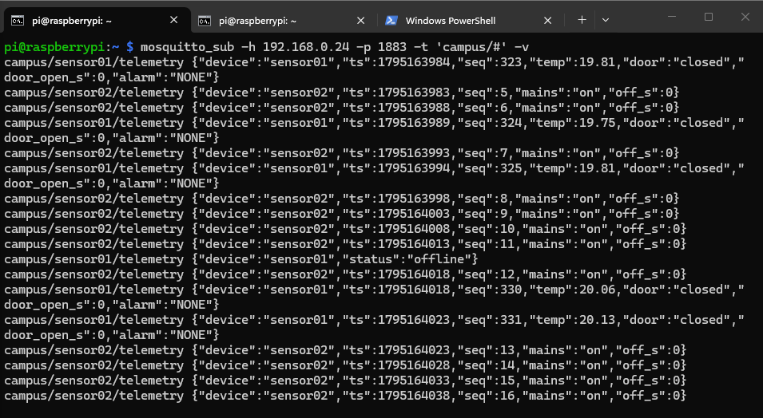
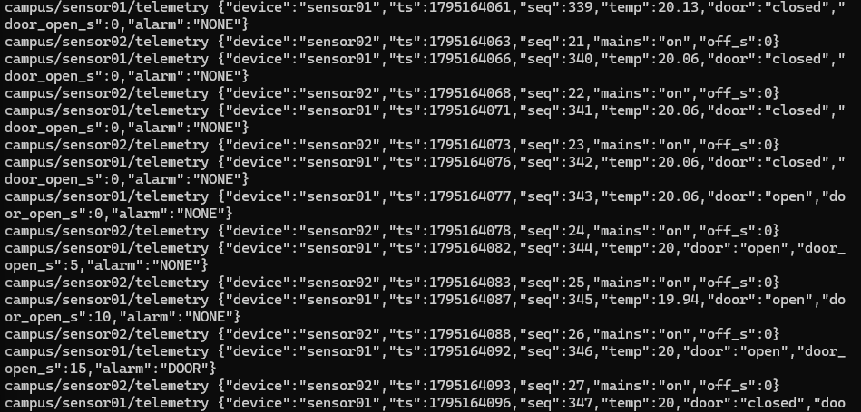
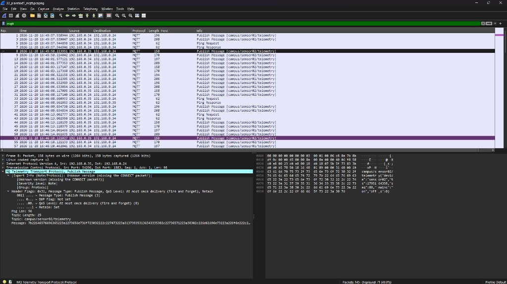
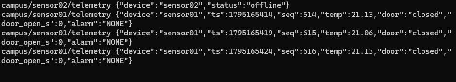
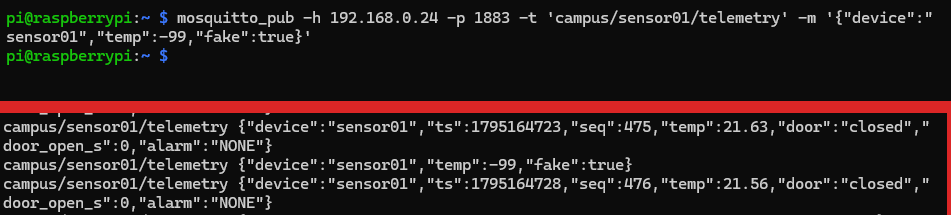

# Stage 6 — Wi-Fi + Plaintext MQTT Baseline (Port 1883)

**Goal:** Connect both ESP32 nodes (**Node 1: `sensor01`** and **Node 2: `sensor02`**) to the Raspberry Pi 4 edge gateway over 2.4 GHz Wi-Fi using **plaintext MQTT on port 1883**, while keeping local buzzer/LED alarms functional offline. Capture the insecure "before" baseline (cleartext Wireshark payload + spoofed publish) prior to Stage 9 mutual-TLS hardening.

---

## 1. Network Layout & Gateway Setup

All devices share a single 2.4 GHz Wi-Fi LAN (`192.168.0.0/24`):

| Device | Role | IP Address | Notes |
| :--- | :--- | :--- | :--- |
| **Raspberry Pi 4** | Edge Gateway / MQTT Broker | `192.168.0.24` | Raspberry Pi OS (Debian 13), Mosquitto 2.0.21 |
| **Node 1 (`sensor01`)** | Vaccine Fridge Monitor (ESP32) | `192.168.0.34` | DS18B20, reed switch, red LED, active buzzer |
| **Node 2 (`sensor02`)** | Mains Power Monitor (ESP32) | `192.168.0.35` | 5 V resistive divider, active buzzer (Stage 5c) |
| **Windows 11 Laptop** | Flashing, Serial Monitor, Wireshark | `192.168.0.x` | Arduino IDE 2.3.11, Wireshark |

Temporary Stage 6 Mosquitto configuration on the Raspberry Pi 4 (`/etc/mosquitto/conf.d/stage6-plain.conf`):

```conf
listener 1883
allow_anonymous true
```



---

## 2. Firmware Changes

Both sketches (`firmware/node1_fridge/node1_fridge.ino` and `firmware/node2_power/node2_power.ino`) were updated from Stages 4 and 5c:

* **Non-blocking network maintenance (`maintainNetwork`):** Wi-Fi (`15 s` retry) and MQTT (`5 s` retry) reconnects run without blocking `loop()`, ensuring local alarms keep sounding even when Wi-Fi or the broker drops.
* **NTP time sync (`configTime`):** Synchronises UTC epoch timestamps (`ts`) upon Wi-Fi connection.
* **JSON telemetry (`ArduinoJson`):** Published every **5 s** and immediately on state changes (door open/close, alarm transitions, mains on/off) with a monotonic sequence counter (`seq`) and zero personal data (PDPA / M12):
  * `campus/sensor01/telemetry`: `{"device":"sensor01","ts":...,"seq":...,"temp":...,"door":"closed","door_open_s":0,"alarm":"NONE"}`
  * `campus/sensor02/telemetry`: `{"device":"sensor02","ts":...,"seq":...,"mains":"on","off_s":0}`
* **MQTT Last Will & Testament (LWT):** Configured with a **15 s keepalive** (`mqtt.setKeepAlive(15)`) and will payload `{"device":"<id>","status":"offline"}` on each node's telemetry topic so an unclean disconnect is flagged within ~23 s (SR-14).
* **Credential hygiene:** Wi-Fi SSID, Wi-Fi password, and broker IP live exclusively in git-ignored `secrets.h` files.

---

## 3. Tests

| # | Test | Type | Expected | Result |
| :--- | :--- | :--- | :--- | :--- |
| 1 | `mosquitto_sub -h 192.168.0.24 -p 1883 -t 'campus/#' -v` | Positive | JSON telemetry from both `sensor01` and `sensor02` every 5 s | ✅ Both nodes published continuously with incrementing `seq` and epoch `ts` |
| 2 | Open cooler lid (`sensor01`) / toggle mains (`sensor02`) | Positive | Immediate event message without waiting for 5 s tick | ✅ `"door":"open"` published immediately (`ts: 1795164077`), escalating to `"alarm":"DOOR"` at `door_open_s: 15` |
| 3 | Capture port 1883 traffic (`tcpdump` + Wireshark) | Baseline ("before") | Readable JSON payloads on port 1883 | ✅ Wireshark showed cleartext topic and JSON body in `Publish Message` frames |
| 4 | Disconnect network while triggering local alarms on Node 1 | Negative | Local buzzer patterns and red LED continue operating | ✅ Node 1 sounded local alarm patterns autonomously offline |
| 5 | Unplug Node 2 USB power completely | Negative (SR-14) | Broker publishes LWT `"offline"` within ~1.5 × keepalive (~23 s) | ✅ Broker published `{"device":"sensor02","status":"offline"}` while `sensor01` kept publishing |
| 6 | Spoofed `mosquitto_pub` to `campus/sensor01/telemetry` (`temp: -99`) | Baseline attack | Accepted by anonymous port 1883 broker | ✅ Fake payload `{"device":"sensor01","temp":-99,"fake":true}` accepted in `mosquitto_sub` |

---

## 4. 📸 Evidence

| File | Shows |
| :--- | :--- |
| `30_network_diagram.png` | Stage 6 network layout (Raspberry Pi 4 `192.168.0.24`, Node 1 `.34`, Node 2 `.35`, laptop) |
| `31_sub_both_nodes.png` | `mosquitto_sub` receiving 5 s telemetry from both `sensor01` and `sensor02` |
| `32_event_messages.png` | Immediate MQTT event message on door open (`door_open_s` → `alarm:"DOOR"`) |
| `33_plaintext_mqtt.png` | Wireshark inspecting cleartext MQTT `Publish Message` JSON payload on port 1883 |
| `33_plaintext_mqtt.pcapng` | Packet capture of port 1883 traffic from `tcpdump` ([download](33_plaintext_mqtt.pcapng)) |
| `34_local_alarm_offline.mp4` | Video confirming Node 1 local buzzer alarms work offline *(shared via team WhatsApp)* |
| `35_lwt_offline.png` | Broker publishing Node 2 LWT `{"device":"sensor02","status":"offline"}` after unplug |
| `36_spoofed_publish.png` | Unauthenticated `mosquitto_pub` spoof payload accepted on `campus/sensor01/telemetry` |











---

## 5. Problems & Fixes

* **ESP32 upload failed (`Wrong boot mode detected (0x13)`):** Resolved by holding the `BOOT` button on the ESP32 DevKitC when `Connecting...` appeared until `Writing at...` started.
* **Stage 5c Node 2 buzzer missing in handoff zip:** Merged Stage 5c (`node2_power.ino` with active buzzer on GPIO 18) before adding Stage 6 Wi-Fi/MQTT.
* **`ufw: command not found` on Raspberry Pi 4:** Newly flashed Raspberry Pi OS (Debian 13) did not have `ufw` pre-installed, so port 1883 was reachable for Stage 6; `ufw` will be installed and configured in Stage 10 hardening.
* **Physical Raspberry Pi 4 vs VirtualBox VM:** Using a physical Raspberry Pi 4 directly on the shared 2.4 GHz Wi-Fi avoided VirtualBox host-only/bridged networking issues and matches the proposal architecture.

---

## 6. Result

- [x] Stage 6: Both nodes publish valid JSON telemetry over plaintext MQTT (1883) to the Raspberry Pi 4 broker, local safety alarms run independently offline, LWT detects silent node failure within ~23 s, and plaintext/spoofing baseline evidence is recorded.

**Next:** Stage 7 — Gateway `bridge.py` forwarding telemetry to Mobius 3.0.1 (oneM2M).
