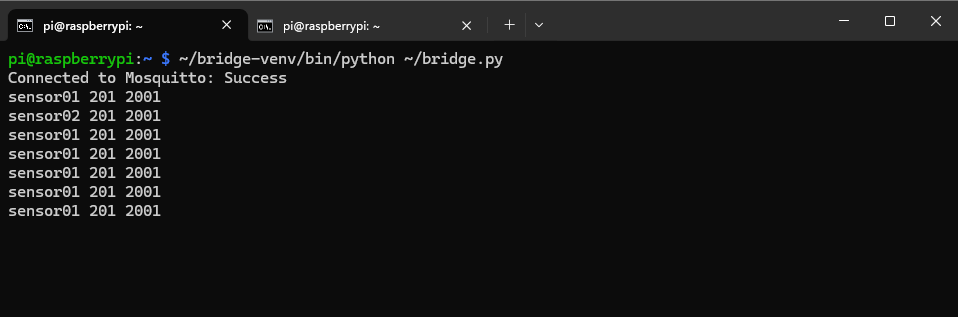
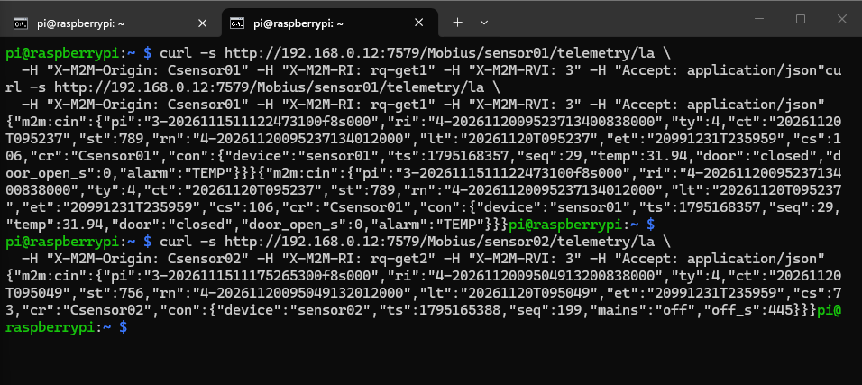
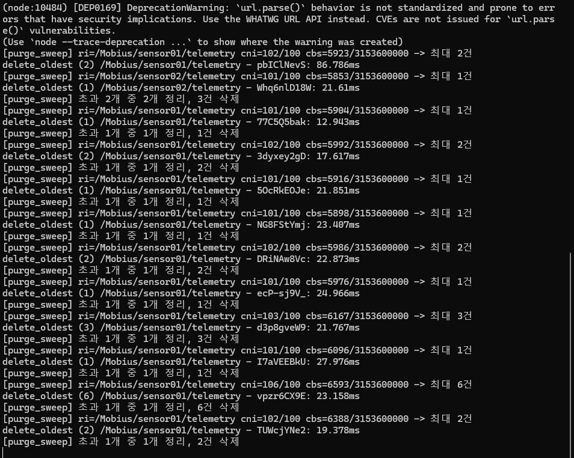
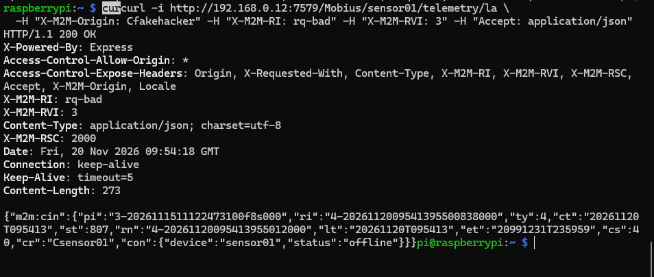

# Stage 7 — Edge Gateway (`bridge.py`) + Mobius 3.0.1 oneM2M

**Goal:** Forward live JSON telemetry from Mosquitto on the Raspberry Pi 4 (`192.168.0.24:1883`) into the Mobius 3.0.1 oneM2M IN-CSE (`192.168.0.12:7579`, backed by MySQL 8.4), creating one `<cin>` contentInstance per reading under `/Mobius/sensor01/telemetry` and `/Mobius/sensor02/telemetry`. Capture the baseline lack of origin enforcement (`F4`) ahead of Stage 11 oneM2M ACPs.

---

## 1. Architecture & Setup

* **Edge Gateway (Raspberry Pi 4, `192.168.0.24`):** Runs `gateway/bridge.py` inside a Python virtual environment (`~/bridge-venv`), subscribing to `campus/+/telemetry` on `localhost:1883` and POSTing each JSON payload to `http://192.168.0.12:7579/Mobius/<device>/telemetry`.
* **Backend Server (Windows 11, `192.168.0.12`):** Runs Mobius 3.0.1 (`csebaseport: 7579`) backed by MySQL 8.4.
* **Host Firewall Update:** Updated Windows Firewall rule `Mobius-7579-Gateway-Only` to allow inbound TCP port `7579` from the Raspberry Pi 4 (`192.168.0.24`).
* **oneM2M Resource Tree:** Verified Application Entities `/Mobius/sensor01` and `/Mobius/sensor02`, each containing a `telemetry` container (`mni: 1000`).

---

## 2. Tests

| # | Test | Type | Expected | Result |
| :--- | :--- | :--- | :--- | :--- |
| 1 | `curl -i http://192.168.0.12:7579/Mobius` from Pi 4 | Positive | `200 OK` (`X-M2M-RSC: 2000`) | ✅ Pi 4 reaches Mobius through `Mobius-7579-Gateway-Only` firewall rule |
| 2 | Run `bridge.py` with both ESP32s online | Positive | `sensor01 201 2001` and `sensor02 201 2001` | ✅ Every telemetry packet created a `<cin>` in Mobius |
| 3 | Query `/Mobius/sensor01/telemetry/la` and `/Mobius/sensor02/telemetry/la` | Positive | Latest JSON payloads (`temp`, `door`, `mains`, `off_s`) returned | ✅ Both `/la` queries returned live device telemetry (`st: 789`, `st: 756`) |
| 4 | Query `/Mobius/sensor01/telemetry/la` with fake `X-M2M-Origin: Cfakehacker` | Negative / Baseline (`F4`) | Accepted without ACP (`200 OK`), proving default-open CSE before Stage 11 | ✅ Returned `200 OK` (`X-M2M-RSC: 2000`) — baseline recorded for Stage 11 mitigation |

---

## 3. 📸 Evidence

| File | Shows |
| :--- | :--- |
| `40_bridge_201.png` | `bridge.py` on Raspberry Pi 4 receiving `sensor01` and `sensor02` and receiving `201 2001` from Mobius |
| `41_mobius_la.png` | `curl` querying `/la` for both `sensor01` and `sensor02` on Mobius |
| `42_mobius_console.png` | Mobius 3.0.1 console processing live telemetry and `purge_sweep` / `delete_oldest` |
| `43_unauth_origin_baseline.png` | Baseline finding F4: fake origin `Cfakehacker` accepted (`200 OK`) prior to Stage 11 ACPs |

---

## 4. Problems & Fixes

* **Windows Firewall blocked Pi 4 IP (`192.168.0.24`):** Lab 4's `Mobius-7579-Gateway-Only` rule was still pinned to the old gateway IP (`192.168.0.28`). Updated `RemoteAddress` to `192.168.0.24`.
* **Debian 13 Python PEP 668 (`externally-managed-environment`):** Used a dedicated virtual environment (`~/bridge-venv`) on the Raspberry Pi 4 for `paho-mqtt` and `requests`.

---

## 5. Result

- [x] Stage 7: `bridge.py` forwards both `sensor01` and `sensor02` MQTT telemetry into Mobius 3.0.1 (`201 2001`), latest readings are queryable via `/la`, and baseline origin-trust finding (`F4`) is documented.
