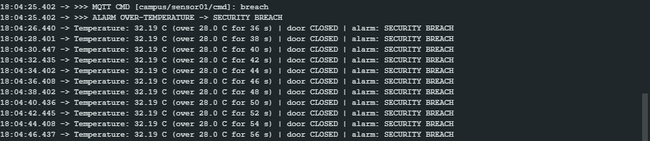
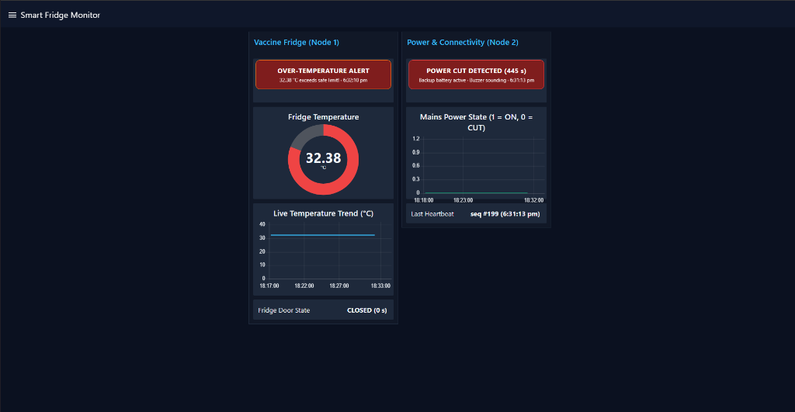
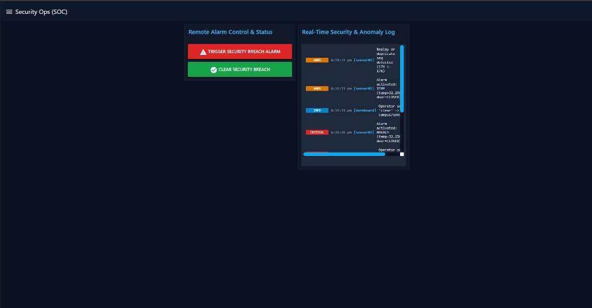

# Stage 8 — Dashboards + Remote Command Path (`campus/sensor01/cmd`)

**Goal:** Map MQTT command messages on `campus/sensor01/cmd` to Node 1's `breach` flag so security alerts can be triggered/cleared remotely, and deploy a dual-view Node-RED dashboard (**Smart Fridge Monitor** + **Security Ops (SOC)**).

---

## 1. Firmware & Dashboard Changes

* **Node 1 (`firmware/node1_fridge/node1_fridge.ino`):**
  * Subscribes to `TOPIC_CMD` (`campus/sensor01/cmd`) on MQTT connect.
  * `onMqttCmd` parses `"breach"` / `"clear"` (plain text or JSON `{"cmd":"breach"}`) and drives the same `breach` boolean flag as the Serial Monitor, enforcing priority (`BREACH > TEMP > DOOR`) and locking the red security LED + fast continuous buzzer pattern.
* **Node-RED Dashboard (`gateway/nodered_flow.json`):**
  * **Tab 1 — Smart Fridge Monitor:** Dynamic status banners for fridge safety and mains power, live temperature donut gauge & trend chart, door open timer, and mains power step chart.
  * **Tab 2 — Security Ops (SOC):** Remote **Trigger Security Breach Alarm** / **Clear Security Breach** buttons publishing to `campus/sensor01/cmd`, plus a real-time security & anomaly feed flagging implausible/spoofed temperatures, sequence replay/gaps, LWT offline drops, and operator commands.

---

## 2. Tests

| # | Test | Type | Expected | Result |
| :--- | :--- | :--- | :--- | :--- |
| 1 | Publish `breach` to `campus/sensor01/cmd` while `TEMP` alarm is active | Positive | `SECURITY BREACH` overrides `OVER-TEMPERATURE` immediately; red LED solid ON + fast buzzer | ✅ Serial Monitor logged `>>> ALARM OVER-TEMPERATURE -> SECURITY BREACH` immediately |
| 2 | View **Smart Fridge Monitor** in Node-RED (`http://localhost:1880/ui`) | Positive | Live `sensor01` temperature (`32.31 °C`) + `sensor02` power cut (`445 s`) rendered with alert banners | ✅ Both cards and live charts updated in real time |
| 3 | Trigger & clear breach from **Security Ops (SOC)** dashboard buttons | Positive | Node 1 responds to dashboard buttons; events logged in SOC feed | ✅ Both `TRIGGER` and `CLEAR` logged with timestamps and severity badges |
| 4 | Observe sequence anomalies / spoof checks in SOC feed | Anomaly detection | Duplicate/replayed `seq` values flagged as `WARN` | ✅ SOC feed caught and logged `Replay or duplicate seq detected (176 <= 176)` |

---

## 3. 📸 Evidence

| File | Shows |
| :--- | :--- |
| `50_remote_breach_serial.png` | Node 1 Serial Monitor receiving `MQTT CMD [campus/sensor01/cmd]: breach` and overriding `OVER-TEMPERATURE` |
| `51_dashboard_coldchain.png` | Node-RED **Smart Fridge Monitor** tab showing live fridge temperature and Node 2 power status |
| `52_dashboard_soc.png` | Node-RED **Security Ops (SOC)** tab showing remote breach buttons and real-time anomaly feed |

---

## 4. Result

- [x] Stage 8: `campus/sensor01/cmd` remotely drives Node 1's `breach` alarm with priority override, and the dual-view Node-RED dashboard (Smart Fridge Monitor + Security Ops SOC) is live and verified.

**Next:** Stage 9 — Mutual TLS on port `8883`, per-device topic ACLs, and signed updates with anti-rollback (`M1–M4`).
